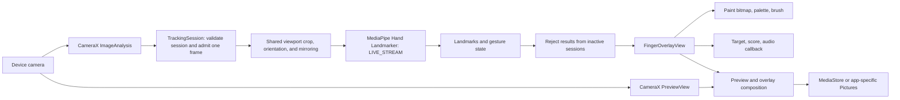
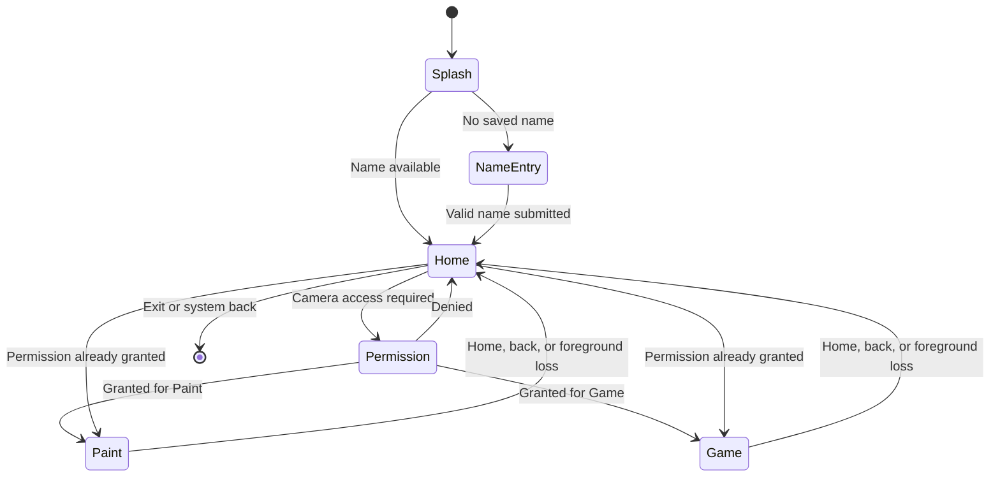

# Finger Spark

Native Android hand tracking with two interaction modes: fingertip painting and target collection. Camera frames are processed on the device using MediaPipe Hand Landmarker. The Android application works offline after installation.

The repository also contains the original browser prototype. The Android application is a separate Kotlin project; it does not embed the web app.

## Capabilities

| Area | Implementation |
| --- | --- |
| Hand tracking | One hand, index fingertip cursor, finger-extension state, estimated hand size |
| Paint | Persistent in-session strokes, nine colors, dwell-based color selection, clear gesture, adaptive brush size |
| Game | Visible-area target placement, collision detection, session score, optional audio feedback |
| Camera | Front/rear selection, fallback to an available lens, shared preview/analysis viewport |
| Navigation | Name entry, personalized home, independent Paint/Game modes, tap-to-reveal toolbar, home and exit |
| Languages | English and Bangla; preference stored locally |
| Capture | Camera preview and overlay composed into a PNG |
| Design | Flat native Views UI, mint/coral mode surfaces, scrollable content, system-inset handling |
| Lifecycle | Session invalidation on exit or backgrounding; stale frames and camera-start callbacks are rejected |

## Architecture

The Android app uses a single `ComponentActivity` with custom Android Views. UI, camera orchestration, and storage are coordinated by `MainActivity`; inference admission and coordinate conversion have separate, testable classes.



### Components

| Component | Responsibility |
| --- | --- |
| `MainActivity.kt` | Screen transitions, permission recovery, CameraX binding, inference integration, localization, capture composition, sound |
| `TrackingSession.kt` | Synchronized session generations and one-frame inference admission; prevents late work from affecting another session |
| `PreviewGeometry.kt` | Center-crop coordinate conversion and target placement within the visible preview |
| `CaptureOutputStream.kt` | Cancels capture writes when their play session ends |
| `FingerOverlayView.kt` | Gesture interpretation, stroke bitmap, brush smoothing, palette dwell, target collisions, scoring |
| `SparkStyle.kt` | Shared palette and interactive surfaces |
| `SparkBackgroundView.kt` | Static home background |
| `GalaxyCircleView.kt` | Home orbit animation |
| `CircleImageView.kt` | Circular creator-photo clipping |
| Bundled assets | Hand landmark model and Lottie animation files |

This is a small single-module application. It does not currently use a repository/data layer, dependency-injection framework, navigation library, or persistent database.

## Application Workflow



1. The launch animation completes or reaches its fallback timeout.
2. First launch collects a name; subsequent launches show the personalized home screen.
3. Choosing a mode requests camera permission if needed.
4. After preview layout, CameraX binds preview and analysis to a shared viewport and the activity lifecycle. Model initialization runs on the analysis worker.
5. Analysis keeps the latest frame. A session gate admits at most one asynchronous inference at a time.
6. Frames are cropped to the shared viewport, oriented for the camera sensor, and mirrored for the front lens.
7. MediaPipe returns normalized landmarks. The index fingertip is landmark `8`.
8. Finger-extension state compares fingertip and proximal-joint vertical coordinates. Hand size is estimated from wrist to middle-finger MCP distance.
9. The overlay maps landmarks into the center-cropped preview and updates the selected mode.
10. Camera shutdown invalidates the session. Delayed startup and inference callbacks cannot reactivate it.

## Interaction Reference

### Paint

| Action | Gesture or control |
| --- | --- |
| Draw | Index finger raised, middle finger folded |
| Move without drawing | Fold the index finger or raise the middle finger |
| Select a color | Hold the fingertip over a swatch for 450 ms |
| Clear | Hold index, middle, ring, and little fingers extended for 600 ms |
| Change brush size | Move the hand toward or away from the camera |
| Save | Tap the screen, then select capture |

The drawing is held in an in-memory bitmap. Entering a mode resets the session; drawings are not restored after app termination. Use capture to retain a result.

### Game

Move the fingertip cursor onto the target. Hit distance is evaluated in screen pixels against the target ring plus a small touch tolerance; off-screen landmarks cannot score. A hit increments the score, relocates the target, and plays a tone when sound is enabled. A 450 ms cooldown prevents repeated capture of the same target. Score is session-local.

### Shared Controls

Tap the camera screen to show the bottom toolbar. It contains home, camera switch, capture, sound, and exit actions, and hides after approximately 2.6 seconds.

The circular language control is available on name entry and home. Mode names remain Paint and Game in both languages.

## Offline Behavior And Data Handling

- Camera is the only user-facing permission. Manifest merge rules explicitly remove internet and network-state permissions contributed by dependencies; no microphone or broad storage access is requested.
- Inference runs locally using `hand_landmarker.task` from the APK.
- Animations are bundled; no runtime asset download is required.
- Name and language are stored in private `SharedPreferences`.
- Automatic application backup is disabled.
- No account, analytics client, backend, or upload path is implemented.
- Camera sessions stop when play loses the foreground. Home animations pause when the activity stops.
- No foreground service, background service, or scheduled worker is implemented.
- Exit stops the camera and removes the activity task. Android controls process retention; an idle cached process is not a running camera session.

### Capture Storage

| Android version | Destination |
| --- | --- |
| Android 10+ / API 29+ | Gallery-visible PNG through MediaStore at `Pictures/Finger Spark` |
| Android 7-9 / API 24-28 | App-specific external Pictures directory; gallery visibility is not guaranteed |

Capture composition runs on the UI thread; PNG encoding and file writes run on a dedicated worker. Writes are cancelled when their play session ends, and failed MediaStore writes remove their pending entry. Unavailable legacy storage fails explicitly instead of using a relative path. Capture omits the toolbar. Camera frames are not continuously recorded.

## Repository Layout

```text
.
|-- README.md
|-- android-app/
|   |-- app/
|   |   |-- build.gradle.kts
|   |   `-- src/
|   |       |-- main/
|   |       |   |-- AndroidManifest.xml
|   |       |   |-- assets/
|   |       |   |-- java/com/handtracker/fingerspark/
|   |       |   `-- res/
|   |       `-- test/java/com/handtracker/fingerspark/
|   |-- docs/design-direction.md
|   |-- gradle/wrapper/
|   |-- gradlew.bat
|   `-- build.gradle.kts
|-- index.html
|-- app.js
|-- styles.css
|-- server.mjs
|-- package.json
`-- package-lock.json
```

## Android Build

### Requirements

- JDK 17
- Android SDK platform 35 and compatible build tools
- Android 7.0 / API 24 or newer for installation
- Internet access for the initial Gradle dependency download
- A physical camera-equipped device for meaningful hand-tracking validation

The project uses Gradle Wrapper 8.10.2, Android Gradle Plugin 8.7.3, and Kotlin 2.0.21. The wrapper can use the project-local toolchain when present; otherwise configure `JAVA_HOME` and `ANDROID_HOME`, or select the installed SDK in Android Studio.

### Build And Check

From the repository root in PowerShell:

```powershell
cd android-app
.\gradlew.bat :app:assembleDebug :app:lintDebug :app:testDebugUnitTest
```

The debug APK is generated at:

```text
android-app/app/build/outputs/apk/debug/app-debug.apk
```

A debug APK is intended for development and manual testing. A production release requires a release signing configuration.

### Install

Enable Developer options and USB debugging on the device, connect it, and approve the computer's authorization request.

```powershell
adb devices
.\gradlew.bat :app:installDebug
```

If `adb` is not on PATH, use `<Android SDK>/platform-tools/adb.exe`. The install command assumes the current directory is `android-app`.

## Browser Prototype

The root web application uses JavaScript, the MediaPipe Hands package, and a local Node HTTP server.

```powershell
npm ci
npm test
npm run dev
```

Open `http://127.0.0.1:3000` and approve camera permission. Browser camera access requires localhost or a secure HTTPS origin. The web prototype has its own behavior and is not a feature-identical Android build.

## Dependencies

| Dependency | Version | Purpose |
| --- | --- | --- |
| CameraX | 1.5.3 | Preview, lens selection, analysis, lifecycle binding |
| MediaPipe Tasks Vision | 0.10.35 | On-device hand landmark inference |
| Lottie Android | 6.6.7 | Bundled splash and hand animations |
| AndroidX Activity KTX | 1.9.3 | Activity and permission APIs |
| AndroidX Core KTX | 1.15.0 | Compatibility helpers |
| JUnit | 4.13.2 | Local regression tests |

## Validation And Limitations

Verification for this revision:

| Check | Result |
| --- | --- |
| Debug APK assembly | Passed |
| Android lint | Passed with no errors; dependency-version and portrait-orientation warnings remain |
| Local regression tests | 17 passed: session invalidation, frame ownership, crop mapping, visible target placement, screen-space hits, and capture cancellation |
| Packaged APK permissions | Inspected to verify camera access and the absence of internet permission |
| Native 16 KB alignment | All bundled arm64-v8a/x86_64 load segments meet 16 KB alignment; APK ZIP alignment check passed |
| Web JavaScript syntax | Passed using `npm test` |
| Physical-device acceptance | Pending; no authorized device detected by ADB |

The web `npm test` command checks syntax; it does not exercise browser camera behavior.

Physical-device acceptance still requires checking permission denial and retry, both cameras, Paint gestures and palette selection, Game scoring, gallery capture, background/foreground transitions, text scaling, and system insets. The current revision has not been revalidated on a connected phone.

Additional constraints:

- One hand is tracked at a time.
- The activity is designed for portrait phones. Tablet, foldable, and landscape layouts have not been certified.
- Finger-state heuristics assume an upright hand; unusual rotations and occlusion can misclassify gestures.
- Lighting, camera quality, motion blur, and device performance affect tracking.
- Sound state, score, and drawings are not persisted.
- Android 7-9 captures use app-specific storage.
- Release signing, store distribution, and release-device compatibility testing are not configured.

See [design direction](android-app/docs/design-direction.md) for the UI brief and visual rules.
See [release-readiness review](android-app/docs/release-review.md) for the audit brief, confirmed fixes, and remaining device checks.
